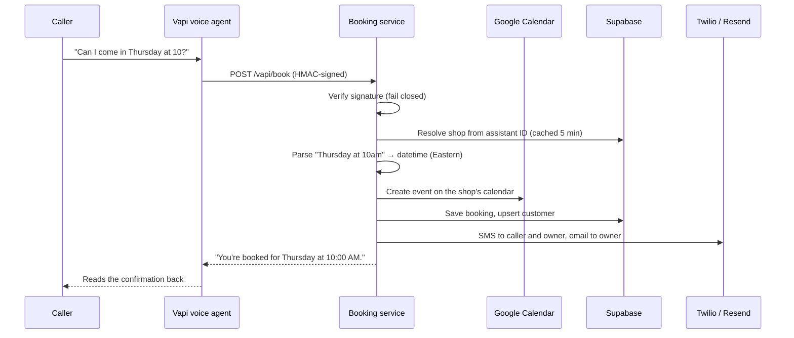

<div align="center">

# ShopDesk · Booking Service

### The backend that turns a phone conversation into a confirmed appointment

When ShopDesk's AI receptionist agrees on a time with a caller, it calls this service. Within seconds, the appointment is on the business's calendar, saved to the database, and confirmed to both the customer and the owner.

[](https://github.com/CodeBen98/shopdesk-booking/actions/workflows/ci.yml)


**This repo: the booking backend** · Owner dashboard: [`shopdesk-dashboard`](https://github.com/CodeBen98/shopdesk-dashboard)

</div>

---

## Contents

- [Where it fits](#where-it-fits)
- [What happens on a booking](#what-happens-on-a-booking)
- [Design decisions](#design-decisions)
- [API](#api)
- [Tech stack](#tech-stack)
- [Running locally](#running-locally)
- [Tests and CI](#tests-and-ci)
- [Code map](#code-map)

## Where it fits

ShopDesk gives local businesses an AI phone receptionist. The voice agent (Vapi) handles the conversation; **this service handles the action**. It's called as a tool in the middle of a live call, so it has to be fast, correct, and safe for many businesses at once.

## What happens on a booking



## Design decisions

| Decision | Why |
|---|---|
| **Fail closed on authentication** | If the webhook secret isn't configured, every request is rejected. Accepted credentials are a bearer token, a shared token header, or an HMAC-SHA256 signature of the raw body, all compared in constant time. |
| **Strict multi-tenancy, no fallbacks** | Every action is scoped to the shop that owns the calling assistant. If shop-specific data (phone number, owner contact, calendar) is missing, the step is skipped and logged instead of reaching the wrong business. |
| **No PII in logs** | Logs record whether a name or phone was provided, never the values. |
| **Async I/O** | FastAPI with `httpx`; the synchronous Google client runs in an executor so one slow API call doesn't block other bookings. |
| **Natural-language times** | Callers say things like "Thursday at noon" or "October 14 at 3pm"; the parser resolves these to concrete appointment times (Eastern time). |
| **Narrow OAuth scope** | Calendar access uses only the `calendar.events` scope, the narrowest one that can check availability and create bookings. |

## API

| Method | Path | Purpose |
|---|---|---|
| `POST` | `/vapi/book` | Booking in Vapi's tool-call format |
| `POST` | `/book` | Booking in plain JSON (same logic) |
| `GET` | `/health` | Health check |

When running locally, interactive docs are at **`/docs`** (Swagger UI).

## Tech stack

| Area | Technology |
|---|---|
| API | Python 3.9+, FastAPI, Uvicorn, Pydantic, httpx |
| Integrations | Google Calendar API (OAuth), Twilio SMS, Resend email, Supabase REST |
| Quality | pytest, GitHub Actions (Python 3.9 and 3.12) |
| Hosting | Render (`render.yaml`) |

## Running locally

```bash
git clone https://github.com/CodeBen98/shopdesk-booking.git
cd shopdesk-booking
python3 -m venv .venv && source .venv/bin/activate
pip install -r requirements.txt -r requirements-dev.txt
cp .env.example .env              # add your own keys
uvicorn booking_webhook:app --reload --port 8000
```

Then open http://localhost:8000/health or http://localhost:8000/docs.

## Tests and CI

```bash
python -m pytest -q
```

The suite covers the health check; webhook authentication (no secret configured, wrong token, valid token, valid and tampered HMAC signatures); phone-number normalization; and natural-language time parsing. GitHub Actions runs it on Python 3.9 and 3.12 for every push to `main` and every pull request.

## Code map

| File | Responsibility |
|---|---|
| `booking_webhook.py` | FastAPI app: authentication, shop resolution, booking flow, Supabase writes, email |
| `calendar_service.py` | Google Calendar availability and event creation with per-shop OAuth tokens |
| `sms_service.py` | Per-shop Twilio SMS: customer confirmation, owner alert, emergency alert |
| `tests/` | pytest suite |
| `render.yaml`, `Procfile` | Deployment |

---

<div align="center">

Built by **Slarve Benoit** · [@CodeBen98](https://github.com/CodeBen98)

</div>
